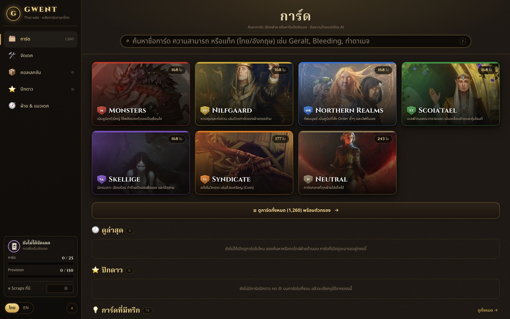
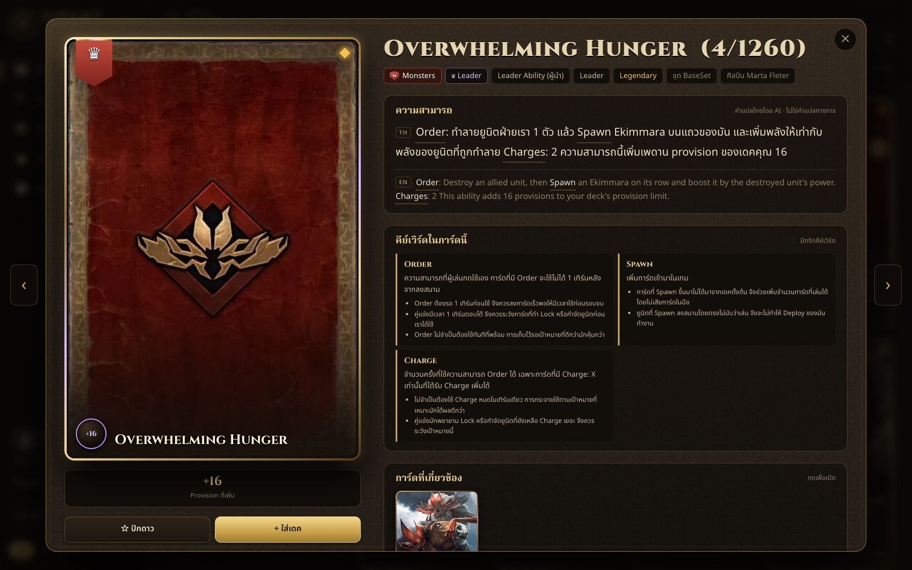

# GWENT-Thai-wiki

คลังการ์ด GWENT ภาษาไทย ทำโดยแฟน · A Thai-language GWENT card library made by a fan.

### 👉 [เปิดเว็บ: gister900.github.io/GWENT-Thai-wiki](https://gister900.github.io/GWENT-Thai-wiki/)

> **This is an unofficial fan work and is not approved/endorsed by CD PROJEKT RED.**
> เว็บนี้เป็นผลงานแฟนที่ไม่เป็นทางการ ไม่ได้รับการอนุมัติหรือรับรองจาก CD PROJEKT RED

## ทำอะไรได้บ้าง
- **ค้นการ์ดทั้ง 1,260 ใบ** ด้วยชื่อ ความสามารถ หรือแท็ก ได้ทั้งภาษาไทยและอังกฤษ · กรองตามฝ่าย ประเภท ความหายาก provision
- **ข้อความการ์ดภาษาไทย** พร้อมคำอธิบายคีย์เวิร์ด · การ์ดที่เล่นคู่กัน · token ที่เกี่ยวข้อง · ทริกจากผู้เล่น (มีลิงก์แหล่งที่มา)
- **หน้าฝ่ายและแนวเดค** สรุปจุดเด่นแต่ละฝ่ายพร้อมการ์ดหลัก
- **จัดเดค** เช็กกติกา (25 ใบ · ยูนิต 13 · provision) และแนะนำการ์ดที่เข้ากับเดค
- **ติ๊กคอลเลกชัน + แผนคราฟต์** บอกว่าต้องใช้ scraps เท่าไหร่ · export/import ไฟล์ได้
- ใช้ได้ทั้งมือถือและคอม · ข้อมูลที่ติ๊กเก็บในเบราว์เซอร์ของคุณเท่านั้น · ไม่มีโฆษณา

**English:** search all 1,260 collectible cards (Thai or English), read Thai card text with keyword help, card pairings and community tips, browse factions and deck archetypes, build decks with rule checks and suggestions, and track your collection with a crafting plan. Everything you save stays in your own browser. No ads.

## เครดิต / Credits
- ข้อมูลการ์ด: [gwent.one API](https://api.gwent.one/)
- รูปการ์ด: [playgwent.com](https://www.playgwent.com/) (เว็บทางการของ CD PROJEKT RED) · ภาพ token บางใบจาก gwent.one
- ข้อความการ์ดภาษาไทยแปลโดย AI ไม่ใช่คำแปลทางการ อาจคลาดเคลื่อนได้ (Thai card text is machine-translated, not official)
- ทริกและแนวเดคมีลิงก์แหล่งที่มากำกับไว้ในแต่ละข้อ
- GWENT® and The Witcher® are trademarks of CD PROJEKT S.A. · GWENT และ The Witcher เป็นเครื่องหมายการค้าของ CD PROJEKT

## License
โค้ดใช้ [MIT License](LICENSE) **เฉพาะโค้ดเท่านั้น** · ข้อมูลการ์ด ข้อความ รูป และทุกอย่างของ GWENT / The Witcher เป็นของ CD PROJEKT RED ไม่อยู่ใต้ license นี้ ใช้ในฐานะแฟนคอนเทนต์ตาม [กติกาแฟนคอนเทนต์ของ CD PROJEKT RED](https://cdprojektred.com/fan-content)

The MIT license covers the code only. GWENT card data and images belong to CD PROJEKT RED.

_นักพัฒนา: วิธี build และกติกาโค้ดอยู่ใน [CONTRIBUTING.md](CONTRIBUTING.md)_
